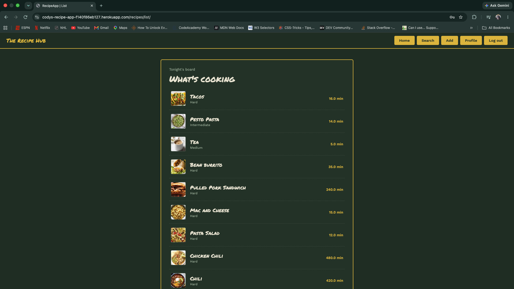

# The Recipe Hub

A full-stack Django recipe manager. Browse a board of recipes, search by difficulty with generated charts, and (with an account) add your own recipes with photos.

**Live demo:** https://codys-recipe-app-f140f86eb127.herokuapp.com/

> No account needed to look around: the recipe list, recipe pages, search/reporting page, and profile are all public. Adding recipes requires an account, and deleting is restricted to the admin.



<!-- Tip: run a search on the live site, screenshot the table + chart, save it as screenshots/search.png, then uncomment the line below.

-->

---

## Features

- **Browse recipes** with photos, difficulty, and cooking time, no login required
- **Recipe detail pages** with ingredients and instructions
- **Search and reporting:** pick a difficulty and chart type (bar, pie, or line) to get a table of matching recipes plus a chart of cooking times, built with Pandas and Matplotlib
- **User accounts:** sign up, log in, and log out using Django's built-in authentication
- **Add recipes** with image uploads (logged-in users)
- **Admin-only deletion:** the delete button appears only for the superuser, and the server re-checks permission on every request. Deletes are POST-only with a confirmation prompt
- **Auto-calculated difficulty** derived from cooking time and ingredients

## Tech Stack

| Area | Tools |
| --- | --- |
| Backend | Python 3.12, Django 4.2, Gunicorn |
| Database | PostgreSQL (production), SQLite (development) |
| Data and charts | Pandas, NumPy, Matplotlib |
| Media | Pillow (ImageField uploads) |
| Frontend | Django templates, custom CSS (no framework) |
| Deployment | Heroku, WhiteNoise, Git and GitHub |

## Project Structure

```text
recipe_project/
├── recipe_project/     # project settings, root urls, login/logout views
├── recipes/            # models, views, forms, templates, static files
├── users/              # sign-up form and view
├── templates/auth/     # login and sign-up templates
├── media/recipes/      # uploaded recipe images
├── screenshots/
├── requirements.txt
├── Procfile
└── manage.py
```

## Running Locally

```bash
git clone https://github.com/Cody-Ayers/Recipe-app.git
cd Recipe-app

python -m venv venv
source venv/bin/activate        # Windows: venv\Scripts\activate

pip install -r requirements.txt
python manage.py migrate
python manage.py createsuperuser
python manage.py runserver
```

Then open http://127.0.0.1:8000. Log in with your superuser account to see the delete controls.

### Environment variables (production)

```text
DATABASE_URL
DJANGO_SECRET_KEY
```

## Deployment

The app runs on Heroku with PostgreSQL, Gunicorn, and WhiteNoise for static files.

```bash
git push heroku main
heroku logs --tail -a codys-recipe-app
```

Maintenance completed along the way: upgraded the Heroku stack (Heroku-22 to Heroku-24) and Python runtime (3.9 to 3.12), updated dependencies, and restored recipe data and images in the production database.

## What This Project Demonstrates

- Building a full-stack app with Django: models, class- and function-based views, forms, templates, and URL routing
- Authentication and authorization: signup and login, `login_required`, and superuser-only actions enforced on both the template and the server
- Safe destructive actions: POST-only delete with CSRF protection and a confirmation prompt
- Data processing and visualization with Pandas and Matplotlib inside a web app
- File uploads and media handling
- Deploying, maintaining, and upgrading a production app on Heroku with PostgreSQL

## Roadmap

- Per-user recipe ownership
- Recipe categories and favorites
- Cloud image storage
- REST API

## Author

**Cody Ayers**, [GitHub](https://github.com/Cody-Ayers) · [Portfolio](https://cody-ayers.github.io/PortfolioWebsite/)

Built as part of a software engineering portfolio and coursework.
